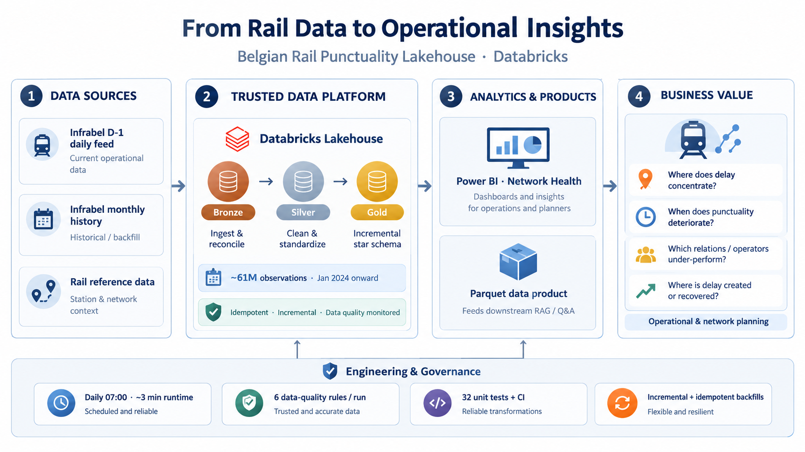
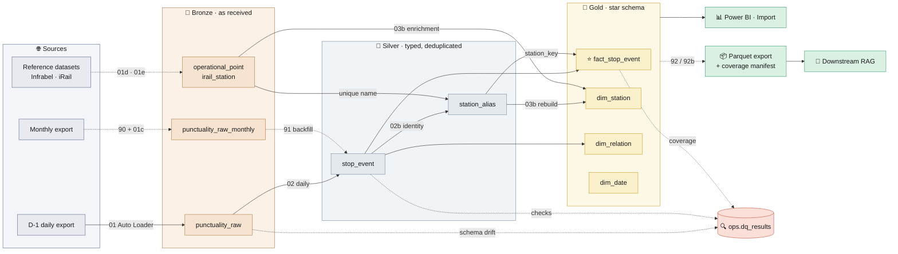
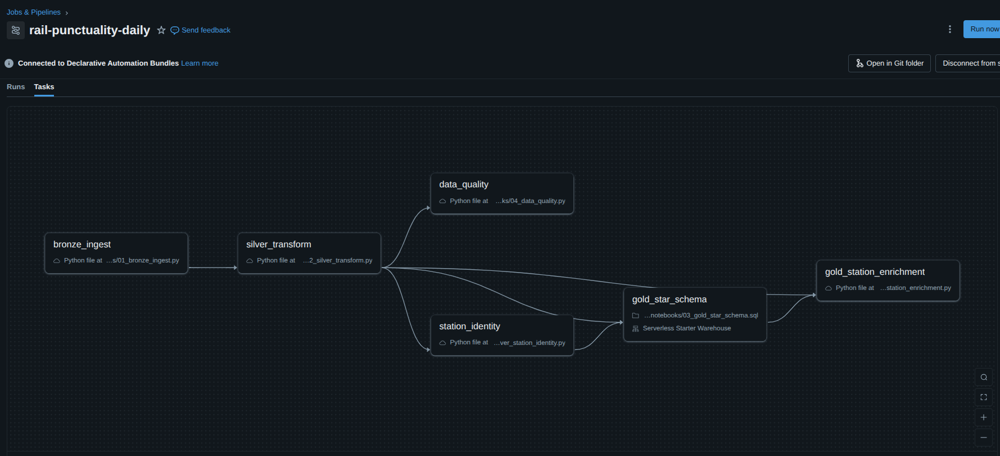
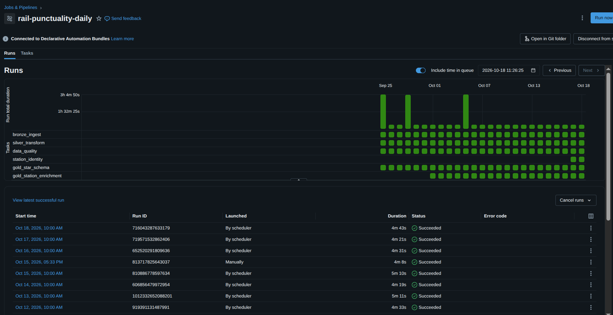
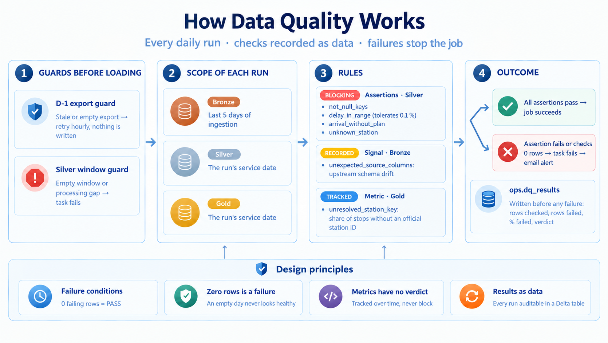
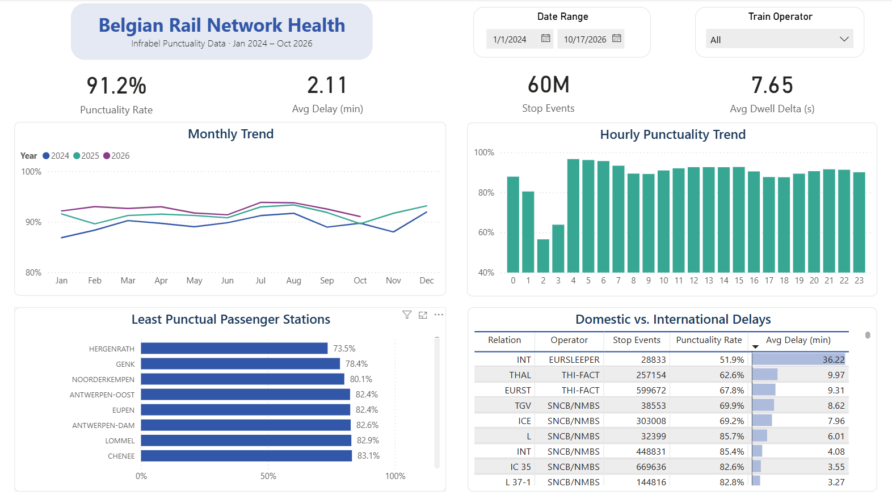

# Rail Punctuality Lakehouse 🚆


[](https://github.com/BeatrizJover/rail-punctuality-lakehouse/actions/workflows/ci.yml)

A medallion-architecture lakehouse on Databricks that ingests Belgian rail punctuality open data (Infrabel), reconciles two structurally different exports, and models them into an incrementally maintained star schema for analysis in Power BI and for a downstream [question-answering layer](https://github.com/BeatrizJover/rail-punctuality-rag).

The pipeline runs as a scheduled Databricks Job, deployed end to end with Databricks Asset Bundles. It is built around production concerns: incremental processing, idempotent reruns and backfills, data quality recorded as data, and transformation logic that is unit-tested outside Databricks.



## Table of Contents

- [Architecture](#architecture)
- [Repository Structure](#repository-structure)
- [Tech Stack](#tech-stack)
- [Pipeline Orchestration](#pipeline-orchestration)
- [Data Quality](#data-quality)
- [Usage](#usage)
- [Environment](#environment)
- [Testing](#testing)
- [Dashboard](#dashboard)
- [Roadmap](#roadmap)

## Architecture



Solid edges are the scheduled path; dotted edges are ad-hoc loads or observations about the data. Edge labels reference the notebook that performs the step. `dim_date` is a generated calendar with no upstream dependency.

**Station identity.** The daily feed has no `PTCAR_NO`, so Silver keys on `stop_point_key` (MD5 of the normalized name) and Gold on `PTCAR_NO`, bridged by `silver.station_alias`. Unresolved stop points share `station_key = -1` until they resolve.

## Repository Structure

```
rail-punctuality-lakehouse/
├── .github/
│   └── workflows/
│       └── ci.yml                                # pytest + ruff on push and pull request
├── databricks.yml                                # Asset Bundle definition (targets, sync, variables)
├── pyproject.toml                                # Package + pytest + ruff configuration
├── requirements.txt                              # Local test dependencies
├── LICENSE
├── README.md
├── docs/
│   └── img/                                      # Screenshots referenced by this README
├── resources/
│   └── rail_punctuality_daily.job.yml            # Job definition — single source of truth
├── notebooks/                                    # Thin task entrypoints
│   ├── 00_setup.sql                              # Catalog, schemas, volumes
│   ├── 00_migration_dim_station_enrichment.py    # One-shot: add and backfill station attributes
│   ├── 00_migration_dim_station_reseed.sql       # One-shot: drop the fact-derived column
│   ├── 00_migration_fact_stop_point_key.py       # One-shot: add and backfill fact stop_point_key
│   ├── 00_migration_silver_source_feed.sql       # One-shot: add and backfill source_feed
│   ├── 00_migration_silver_station_alias_seed.py # One-shot: seed silver.station_alias
│   ├── 00_migration_station_key_ptcar.py         # One-shot: re-key Gold stations on PTCAR_NO
│   ├── 01_bronze_ingest.py                       # D-1 fetch + Auto Loader ingest        [scheduled]
│   ├── 01c_bronze_monthly_ingest.py              # Monthly export ingest, one year/run   [ad-hoc]
│   ├── 01d_bronze_operational_point.py           # Operational points reference          [ad-hoc]
│   ├── 01e_bronze_irail_station.py               # iRail NMBS/SNCB station list          [ad-hoc]
│   ├── 02_silver_transform.py                    # Type, dedup, enrich, MERGE            [scheduled]
│   ├── 02b_silver_station_identity.py            # Stop point → PTCAR_NO resolution      [scheduled]
│   ├── 03_gold_star_schema.sql                   # Incremental dimensional model         [scheduled]
│   ├── 03b_gold_station_enrichment.py            # dim_station, key repair, enrichment   [scheduled]
│   ├── 04_data_quality.py                        # DQ orchestration                      [scheduled]
│   ├── 90_backfill_history.py                    # Monthly file download utility         [ad-hoc]
│   ├── 91_backfill_silver_gold.py                # Silver + Gold backfill, one year/run  [ad-hoc]
│   ├── 92_export_gold_to_blob.py                 # Gold → Parquet contract on Azure Blob [ad-hoc]
│   └── 92b_export_gold_local.py                  # Gold → Parquet contract on UC Volume  [ad-hoc]
├── src/
│   └── rail/                                     # Testable, importable pipeline logic
│       ├── __init__.py
│       ├── config.py                             # Catalog resolution, endpoints, thresholds
│       ├── ingest.py                             # Export validation — D-1 and reference feeds
│       ├── transforms.py                         # Silver typing / dedup / lookback window
│       ├── identity.py                           # Station alias resolution, dim_station build
│       ├── silver_maintenance.py                 # station_alias table maintenance
│       ├── gold_maintenance.py                   # dim_station rebuild, fact key repair, enrichment
│       └── quality.py                            # DQ rule definitions + evaluation
└── tests/
    ├── conftest.py
    ├── test_config.py
    ├── test_identity.py
    ├── test_ingest.py
    ├── test_transforms.py
    └── test_quality.py
```

## Tech Stack

- **Platform**: Databricks Free Edition, serverless compute, Databricks SQL Warehouse
- **Storage**: Delta Lake (liquid clustering, Predictive Optimization), Unity Catalog Volumes
- **Ingestion**: Auto Loader (`cloudFiles`, rescue mode) for daily; declared-schema batch reads for monthly
- **Processing**: PySpark, Spark SQL
- **Orchestration**: Databricks Jobs + Databricks Asset Bundles (DAB)
- **Modeling**: Medallion architecture (Bronze / Silver / Gold), star schema
- **Publishing**: Parquet on Unity Catalog Volumes / Azure Blob (ABFS), PyArrow for contract verification
- **Data source**: Infrabel / SNCB via the OpenDataSoft API
- **Analytics**: Power BI Desktop, Import mode over the Gold star schema
- **Testing / CI**: pytest, ruff, GitHub Actions

## Pipeline Orchestration

### Scheduled job

Runs daily at **10:00 Europe/Brussels** on serverless compute. The job is defined in `resources/rail_punctuality_daily.job.yml` and deployed with Databricks Asset Bundles; no manual edits in the workspace.



| Task | Purpose |
|---|---|
| `bronze_ingest` | Fetches the D-1 export, rejects stale or empty payloads, ingests with Auto Loader. Retries hourly (max 3) to absorb late upstream publication |
| `silver_transform` | Reads Bronze rows ingested in the last 5 days, types and deduplicates them, and `MERGE`s only newer rows into `silver.stop_event`; the monthly feed wins on overlap. Fails on an empty window or a processing gap. Publishes `service_date` as a task value |
| `station_identity` | Resolves each stop point to a `PTCAR_NO` in `silver.station_alias` — monthly native ID first, then a unique reference name — and logs every change to `silver.station_alias_changes` |
| `gold_star_schema` | `MERGE`s the fact and `dim_relation` for that `service_date` only, with `station_key` taken from the alias table — no full Silver scan |
| `gold_station_enrichment` | Rebuilds `dim_station` from the aliases, re-points fact rows whose stop point resolved late, refreshes `station_type`, `is_passenger` and coordinates, and records the coverage metric |
| `data_quality` | Evaluates the DQ rules and appends results to `ops.dq_results` |

Failure notifications are configured at job level. The schedule sits after Infrabel's D-1 refresh: an earlier 05:30 slot silently ingested the previous service date, which the export guard now turns into a failed, retryable task.



*The ~3 h runs (Sep 25, Sep 28, Oct 5) are `bronze_ingest` retrying hourly until a late D-1 export was published, under the earlier 07:00 schedule. Since the move to 10:00, a run takes 4–5 min.*

### Backfill and publishing (ad-hoc)

Monthly exports (~2M rows each) are loaded by hand, one year per run, outside the schedule.

| Notebook | Writes | Runs after |
|---|---|---|
| `90_backfill_history.py` | `landing/monthly/*.csv` | — |
| `01c_bronze_monthly_ingest.py` | `bronze.punctuality_raw_monthly` | `90` |
| `91_backfill_silver_gold.py` | `silver.stop_event`, `silver.station_alias`, Gold fact and dimensions | `01c` |
| `92b_export_gold_local.py` | Date-partitioned Parquet + coverage manifest on a UC Volume, plus RAG test fixtures | `91` or the daily job |
| `92_export_gold_to_blob.py` | Same layout on Azure Blob (storage not configured yet) | `91` or the daily job |

- The Gold export layout is a contract consumed by [rail-punctuality-rag](https://github.com/BeatrizJover/rail-punctuality-rag). It is versioned: the manifest carries `contract_version`, and each version publishes to its own prefix (`gold_v2/`), so a breaking change never mixes partitions of two contracts.
- `00_migration_*` notebooks are one-shot and run manually before deploying the change they support.
- Do not run backfills right before the scheduled job: `max_concurrent_runs: 1` does not serialize them against it.

## Data Quality



Every scheduled run appends one row per rule to `ops.dq_results`: rows checked, rows failed, failure percentage and verdict. Rules are failure conditions, so `rows_failed == 0` means PASS. An assertion over 0 rows fails.

| Layer | Rule | Catches / measures | Scope |
|---|---|---|---|
| Silver | `not_null_keys` | Broken natural key | Run's `service_date` |
| Silver | `delay_in_range` | Implausible delay values | Run's `service_date` |
| Silver | `arrival_without_plan` | Actual arrival with no planned counterpart | Run's `service_date` |
| Silver | `unknown_station` | Missing or empty station name | Run's `service_date` |
| Gold | `unresolved_station_key` | Fact rows not yet resolved to a `PTCAR_NO` (`station_key = -1`) | Run's `service_date` |
| Bronze | `unexpected_source_columns` | Upstream schema drift, via Auto Loader's `_rescued_data` | Last 5 days of ingestion (`_ingested_at`), as read by Silver |

- **Drift is a signal, not a failure.** Bronze ingests in rescue mode, so a new upstream column lands in `_rescued_data` and this rule reports it.
- **Coverage is a metric, not an alert.** `unresolved_station_key` should stay near zero. It writes `passed = NULL`; read it through `pct_failed`.
- **Scoped to the run's `service_date`**, passed as a task value by `silver_transform`: no full scans, safe on reruns and backfills.
- **Blocking.** Results are written first, then the task fails if a Silver assertion fails. `delay_in_range` tolerates up to 0.1 % outliers, the rest tolerate none. Schema drift (`unexpected_source_columns`) stays a signal. Backfilled dates are still not evaluated; see the [Roadmap](#roadmap).

Rules live in `src/rail/quality.py` and are unit-tested without a Databricks session.

## Usage

The pipeline runs on Databricks; the local environment exists only to run tests and lint.

```bash
# Clone the repo
git clone https://github.com/BeatrizJover/rail-punctuality-lakehouse.git
cd rail-punctuality-lakehouse

# Local environment (tests and lint only; PySpark needs a JDK 17 on PATH)
python -m venv .venv && source .venv/bin/activate
pip install -r requirements.txt
pytest -q
ruff check .

# Validate and deploy the bundle to your Databricks workspace
databricks bundle validate -t prod
databricks bundle deploy   -t prod
```

### Workspace setup

1. Run `notebooks/00_setup.sql` once with the parameter `catalog = rail_punctuality` to create the catalog, schemas, and volumes before the first job execution.
2. Set `warehouse_id` in `resources/rail_punctuality_daily.job.yml` to a SQL Warehouse in your workspace — the Gold task runs there.
3. *(Optional)* Load history with the [backfill path](#backfill-and-publishing-ad-hoc), one year at a time.
4. *(Optional)* Create the export volume listed in the header of `92b_export_gold_local.py` before publishing Gold.

## Environment

- **Platform**: Databricks Free Edition (serverless compute, environment version 5)
- **Python (Databricks)**: 3.12.3
- **Local development**: Python 3.12.13 in a virtual environment (tests only)

## Testing

`pytest` and `ruff` run on every push to `main` and every pull request (GitHub Actions, Python 3.12, Temurin JDK 17). Spark tests use explicit all-string `StructType` schemas that mirror the source data; `ingest` tests are pure Python.

| Area | Covered |
|---|---|
| Transforms | Punctuality threshold, early arrivals, dedup, blank station names, monthly date normalization |
| Silver window | Bronze lookback filter, processing-gap detection |
| Ingest | D-1 guard: stale, empty, and `DATDEP`-less payloads raise before landing |
| Identity | Alias resolution: monthly recency, reference fallback, `ambiguous` and `unresolved`; `dim_station` build |
| Quality | Rows checked, rows failed, verdict |
| Config | Catalog resolution from `--catalog` and its defaults |

## Dashboard



A single page, **Belgian Rail Network Health**, scoped to passenger stations: four headline cards, a monthly punctuality trend split by year, punctuality by hour of day, the eight least punctual stations, and delays broken down by relation and operator. Date range and train operator are slicers.

The stop-event count on the page reads lower than the ~70M rows in `fact_stop_event` because of the passenger scope; the difference is observations at yards, workshops and service points.

## Roadmap

| Module / Layer | Primary Objective | Status | Priority |
| :--- | :--- | :---: | :---: |
| **Bronze Layer** | D-1 fetch guard — reject stale or empty exports before landing, and name landed files by fetch timestamp | ✅ Done | — |
| **Bronze Layer** | Station classification — `dim_station` carries `station_type`, `is_passenger` and coordinates, derived from the Infrabel operating-point reference and the operator's station list | ✅ Done | — |
| **Silver Layer** | Bounded Bronze read window — the daily run reads only the last 5 days of Bronze ingestion, rewrites only newer rows, drops blank station names, and fails loudly on an empty window or a processing gap | ✅ Done | — |
| **Silver Layer** | Station identity — Gold keyed on `PTCAR_NO` through `silver.station_alias`, resolved from every loaded month and the official reference; replaces the single-month `01b` crosswalk | ✅ Done | — |
| **Data Quality** | Empty-partition rule — an assertion over 0 rows writes `passed = false` | ✅ Done | — |
| **Data Quality** | Alert on failed assertions — the task fails and the job emails on failure | ✅ Done | — |
| **Data Quality** | Decouple the coverage verdict from the assertion verdict in `ops.dq_results` | ✅ Done | — |
| **Data Quality** | Freshness validation (`max(service_date)`) & historical audit job covering backfilled dates — the Bronze guard covers the daily fetch, Silver-level freshness is still open | ⏳ Pending | Medium |
| **Data Quality** | Bronze schema-drift check bounded to Silver's 5-day ingestion window | ✅ Done | — |
| **Gold Layer** | Incremental maintenance — `fact_stop_event` and `dim_relation` by `MERGE`, `dim_station` rebuilt from the aliases; no full Silver scan | ✅ Done | — |
| **Gold Layer** | Extend `dim_date` beyond 2027-12-31 — it is generated once with `CREATE TABLE IF NOT EXISTS` | ⏳ Pending | Medium |
| **Backfill** | Year-scoped monthly ingest and Silver / Gold backfill (`01c`, `91`) | ✅ Done | — |
| **Backfill** | Replace configuration constants in `90` with validated widgets | ⏳ Pending | Low |
| **Publishing** | Date-partitioned Gold Parquet export with coverage manifest | ✅ Done | — |
| **Publishing** | Contract v2 — re-export under `gold_v2/` with `PTCAR_NO` station keys, coordinated with the RAG cut-over | ✅ Done | — |
| **Publishing** | Azure Blob transport (`92`) — implemented; storage account and secret scope not configured | ⏳ Pending | Low |
| **Platform** | Environment isolation — the catalog name is hard-coded in `config.py`, the SQL notebooks and several Python notebooks, and the bundle's `catalog` / `schema` variables are declared but not consumed, so `dev` and `prod` targets write to the same catalog | ✅ Done | — |
| **Platform** | CI: pytest and ruff on every push via GitHub Actions | ✅ Done | — |
| **Analytics** | Power BI report — Network Health page | ✅ Done | — |
| **Maintenance** | File compaction and retention (`OPTIMIZE`, `VACUUM`) — delegated to Databricks Predictive Optimization on Unity Catalog managed tables | ✅ Platform-managed | — |

## Author

**Beatriz Cruz Jover**
[github.com/BeatrizJover](https://github.com/BeatrizJover)

## License

MIT — see [LICENSE](LICENSE).
